<!-- ============================================================
     README CYBERPUNK  ·  reemplaza TU-USUARIO y los links marcados
     Paleta: rosa neon ff2a6d · cian 00f0ff · amarillo f5d300 · violeta b026ff · fondo 07070f
     ============================================================ -->

<p align="center">
  
</p>

<p align="center">
  
</p>

<p align="center">
  <a href="https://www.linkedin.com/in/TU-PERFIL"></a>
  <a href="mailto:TU-CORREO@ejemplo.com"></a>
  
</p>

<p align="center">
  
  
  
</p>

<br>

<!-- ───────────── WHOAMI ───────────── -->
<p align="center"></p>

```json
┌──(laura㉿bogota)-[~]
└─$ cat profile.json
{
  "name":           "Laura Sofía Gutiérrez Duarte",
  "role":           "Full Stack & AEM Developer",
  "experience":     "2+ years in enterprise environments",
  "clients":        ["EPM", "Bancolombia"],
  "core_stack":     ["Java", "AEM", "React", "TypeScript"],
  "security":       "ISO/IEC 27001:2022 Internal Auditor",
  "location":       "Bogotá, Colombia 🇨🇴",
  "availability":   "Open to remote roles"
}
```

<br>

<!-- ───────────── EXPERIENCIA ───────────── -->
<p align="center"></p>

| Rol | Empresa | Lo que hice |
|:----|:--------|:------------|
| **AEM Developer** | NTT DATA<br>*(cuentas EPM y Bancolombia)* | Componentes con **Sling Models** y **HTL**, servicios **OSGi**, integraciones **REST**, autenticación **OAuth2 con Microsoft**, validación **OTP**, **reCAPTCHA**, transmisión de datos cifrada y formularios con **AEM Forms**. |
| **Tech Lead** | Disruptive Information Technologies | Liderazgo técnico de equipo de desarrollo y entrega de producto. |

<br>

<!-- ───────────── STACK ───────────── -->
<p align="center"></p>

<table align="center">
  <tr>
    <td align="center"><b>⚙️ Backend</b></td>
    <td>
      
    </td>
  </tr>
  <tr>
    <td align="center"><b>🎨 Frontend</b></td>
    <td>
      
    </td>
  </tr>
  <tr>
    <td align="center"><b>🧩 AEM</b></td>
    <td>
      
      
      
      
      
    </td>
  </tr>
  <tr>
    <td align="center"><b>🛠️ Tools</b></td>
    <td>
      
    </td>
  </tr>
</table>

<br>

<!-- ───────────── SEGURIDAD ───────────── -->
<p align="center"></p>

<table align="center">
  <tr>
    <td align="center" width="33%">
      <h3>🔐</h3>
      <b>Integraciones seguras</b><br>
      <sub>OAuth2, OTP, reCAPTCHA y transmisión cifrada en proyectos reales</sub>
    </td>
    <td align="center" width="33%">
      <h3>📋</h3>
      <b>Gestión de seguridad</b><br>
      <sub>Auditora interna ISO/IEC 27001:2022</sub>
    </td>
    <td align="center" width="33%">
      <h3>🛰️</h3>
      <b>Auditoría web</b><br>
      <sub>Herramientas propias para analizar cabeceras de seguridad HTTP</sub>
    </td>
  </tr>
</table>

<br>

<!-- ───────────── PROYECTOS ───────────── -->
<p align="center"></p>

<p align="center">
  <a href="https://github.com/TU-USUARIO/header-auditor">
    
  </a>
  <!-- Agrega más proyectos copiando el bloque y cambiando el nombre del repo -->
  <!--
  <a href="https://github.com/TU-USUARIO/OTRO-REPO">
    
  </a>
  -->
</p>

<br>

<!-- ───────────── ESTADISTICAS ───────────── -->
<p align="center"></p>

<p align="center">
  
  
</p>

<p align="center">
  
</p>

<p align="center">
  
</p>

<p align="center">
  
</p>

<br>

<!-- ───────────── CONTACTO ───────────── -->
<p align="center"></p>

```bash
$ ./contact.sh --open-to-collaborate
> Connection established. Let's build something secure.
```

<p align="center">
  <a href="https://www.linkedin.com/in/TU-PERFIL"></a>
  <a href="mailto:TU-CORREO@ejemplo.com"></a>
</p>


